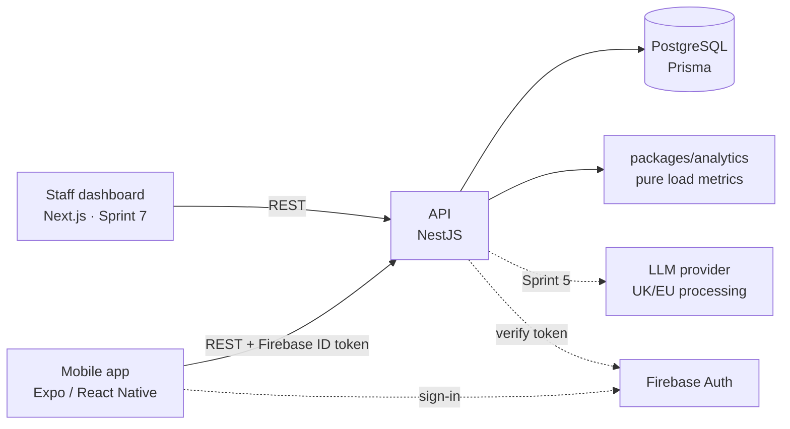

# Design artefacts

Diagrams kept as code (Mermaid or PlantUML) so they version with the system and render at
full resolution in the dissertation. Export PNG/SVG for the report.

## What exists (3 Nov 2026)

- [`erd.md`](erd.md): entity relationship diagram for data model v1, drawn from the Prisma schema on 2 Nov.
- Athlete app screens V1 in Figma (below), built in [`apps/mobile`](../../apps/mobile/README.md) and viewable on
  localhost (DL-010). Differences from Figma: Preview banners on sample-data screens, a Squads section and
  Preview tools in Profile, and a visible unchecked state for the consent checkbox.

## Planned (see `docs/design-plan.md`)

- `architecture.md`: high-level component diagram (week 7)
- `navigation-map.md`: athlete flows, based on the Figma V1 tabs (not yet written)
- Staff overview wireframes (week 5)
- `sequence-*.md`: flag raised, AI assistant tool calling (Sprints 3 and 5)
- `use-cases/`: use case descriptions for the core flows

## Athlete app design V1 (Figma)

- File: [LoadWise V1](https://www.figma.com/design/TqJIKbFrsCVRNd4aZx1Tnd/LoadWise-V1), with two
  pages: **Screens - Light** and **Screens - Dark**.
- Design decisions: DL-006 in [`decision-log.md`](../decision-log.md). Metric definitions behind
  the screens: DL-007. Health-data consent at setup: DL-008.
- Status: **not user tested** and **not checked against WCAG 2.2 AA**. All figures are illustrative
  sample data. The 28-day baseline now matches DL-007; the 1.5 guide stays a configurable
  hypothesis until the Sprint 4 flag spike.

Screens on the light page, as of 3 Nov:

| Group | Screens |
| --- | --- |
| 1. Getting started | Sign in, Sign in / Error, First-time setup (includes a health-data consent checkbox) |
| 2. Today | Today / New user (baseline progress), Today / Usual range, Today / Flagged |
| 3. Logging | Wellness check, Log session, Log session / Missing RPE, Today / Saved offline |
| 4. Flag details | Why this was flagged (value, guide, plain-language explanation, safety note) |
| 5. Trends and profile | Trends, Trends / Not enough data, Profile |

Key choices:

- Three tabs: **Today**, **Trends** and **Profile**. Logging starts from buttons on Today.
- Today is **status first**: one plain-language line ("in your usual range" or a flag) before the numbers.
- Flags use plain language, with the value and the guide shown and a "See why" detail screen.
- A sparkle **AI button** sits at the bottom right on every tab as a future feature (#12, #13, #15).
  There is no chat screen in this version.
- Wellness check: four items scored 1 to 5, 5 best, with a plain-language label at each end
  (for example "Very sore" to "No soreness"). Confirmed on 3 Nov.

Design changes still to make:

- The flag detail sample figures imply ACWR = this week ÷ usual week (3,240 / 2,000 = 1.62). With
  EWMA ACWR (DL-007) that is not true, so the screen must not suggest it.
- "What you can do" text may only suggest talking the next sessions through with a coach, or a
  physio or GP for pain or injury. It never tells the athlete to change load, rest or return to play.
- Add a recent-sessions list (part of #4) opened from the "Latest session" card.
- Staff screens (#10), with wireframes in week 5.

## Current architecture (starting point)

As of 3 Nov only the API, PostgreSQL and `packages/analytics` exist. The mobile app and
dashboard are not built yet, and the API does not verify Firebase tokens yet (it rejects every
token until #1).

