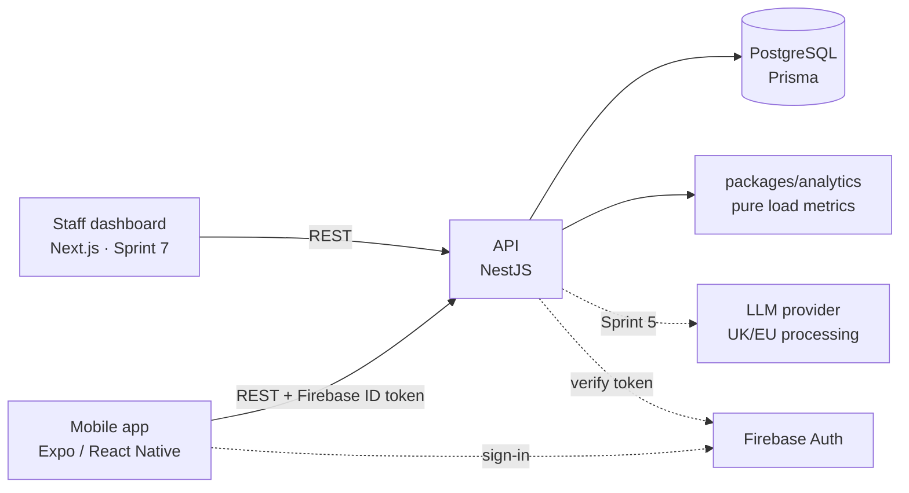

# Design artefacts

Diagrams kept as code (Mermaid or PlantUML) so they version with the system and render at
full resolution in the dissertation. Export PNG/SVG for the report.

Planned (see `docs/design-plan.md`):

- `architecture.md`: high-level component diagram (week 6/7)
- `erd.md`: entity relationship diagram from the Prisma schema (week 7)
- `wireframes/` and `navigation-map.md`: athlete flows (week 2), staff overview (week 5)
- `sequence-*.md`: flag raised, AI assistant tool calling (Sprints 3 and 5)
- `use-cases/`: use case descriptions for the core flows

## Current architecture (starting point)

