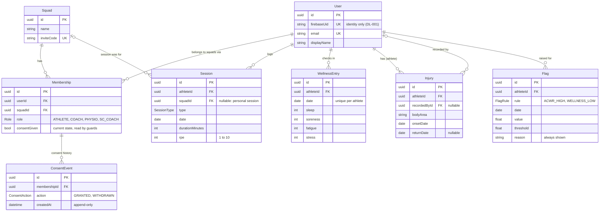

# Entity relationship diagram (data model v1)

Generated by hand from [`apps/api/prisma/schema.prisma`](../../apps/api/prisma/schema.prisma) on 2 Nov 2026.
Update it whenever the schema changes. Design reasoning: DL-002 in [`decision-log.md`](../decision-log.md).

## Reading the diagram

- **Users join squads through Membership**, with a role per squad. One person can be an athlete
  in two squads and a coach in a third.
- **Health data hangs off the athlete (User), not the squad.** That is what lets load be combined
  across every team (FR 2, #8). A session's `squadId` only records which team it was for.
- **Staff access is decided per squad** by the athlete's Membership in that squad: its role and
  `consentGiven`. ConsentEvent keeps the full history of grants and withdrawals.
