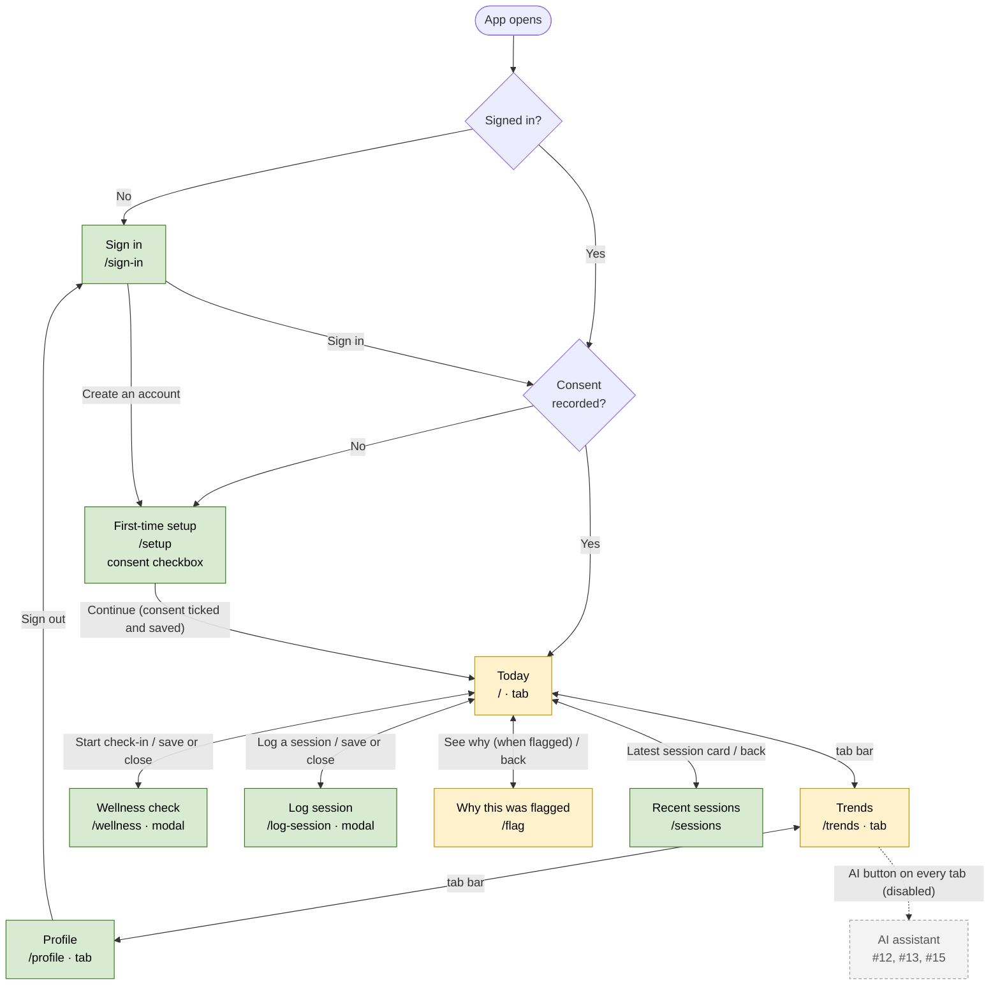
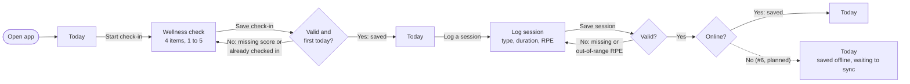

# Athlete app navigation map

How an athlete moves between the screens of the LoadWise mobile app. Drawn from the Expo Router
routes in `apps/mobile/src/app` and the Figma V1 design, as of 20 Nov 2026. Update it whenever a
route or a link between screens changes. Evidence for Ch4 (user interface design) and NFR 1.1
(daily log in 60 s or less).

Key: solid boxes are screens; **real** screens call the API, **preview** screens show labelled
sample data until their story is built; dashed boxes and arrows are planned, not built.

## 1. Screen map

Green: real. Yellow: preview with sample data. Grey dashed: planned. The tab bar links all three tabs
(Today and Profile too); "Forgot password?" on Sign in sends a reset email and stays on the screen.

## 2. Daily logging flow

The task behind NFR 1.1: a wellness check plus one session log in 60 s or less. Both forms start from
Today and open as modals, so the athlete is never more than one tap from Today.

The wellness check is saved through `POST /wellness` (#5), one per day, and a session through
`POST /sessions` (#4). Saving offline and syncing later arrives with #6. The Latest session card on
Today still shows sample data until load metrics arrive (#7), but it opens the real session list.

## 3. Screens, routes and stories

| Screen | Route | Reached from | Story | Status (10 Nov) |
| --- | --- | --- | --- | --- |
| Sign in | `/sign-in` | App start when signed out; Sign out | #1 | Real (Firebase) |
| First-time setup | `/setup` | Create an account; any signed-in user without recorded consent | #1 (AC4) | Real: consent stored through `POST /me/health-consent` (DL-008) |
| Today | `/` (tab) | Sign in, setup, closing any form | #7, #9 | Preview: states New user, Usual range, Flagged, Saved offline |
| Trends | `/trends` (tab) | Tab bar | #7, #9 | Preview |
| Profile | `/profile` (tab) | Tab bar | #1, #2 | Real: account, squads (create and join), sign out |
| Wellness check | `/wellness` (modal) | Today: Start check-in | #5 | Real: saves one check-in per day |
| Log session | `/log-session` (modal) | Today: Log a session | #4 | Real: saves type, duration and RPE |
| Why this was flagged | `/flag` | Today: See why | #9, #12 | Preview: sample flag |
| AI assistant | none | AI button (disabled) | #12, #13, #15 | Planned |
| Recent sessions | `/sessions` | Today: Latest session card | #4 | Real: newest first; offline sessions arrive with #6 |

## 4. Design choices shown by the map

- **Three tabs, logging from Today** (DL-006): the two daily tasks are one tap from the first screen.
- **Logging forms are modals:** closing or saving always returns to Today, so there is no back stack to lose.
- **Status first:** Today leads with one plain-language line, and a flag links to its explanation ("See why").
- **Signed-out users can only reach Sign in:** the tab layout redirects anyone without a session, so no
  health screen is reachable without signing in.
- **No health screen before consent:** the tab layout asks the API (`GET /me`) whether consent is
  recorded and sends anyone without it to setup (#1 AC4). The API also refuses health-data writes
  without consent, so the app check is not the only protection.

## 5. Gaps found while drawing the map

- ~~**Returning users skip setup.**~~ Fixed 20 Nov (#1 AC4, I-7): any user without recorded consent is sent to setup.
- ~~**Setup can be reopened from Profile.**~~ Fixed 20 Nov: the preview link is removed.
- ~~**No recent-sessions screen.**~~ Added 20 Nov (#4): `/sessions`, opened from the Latest session card.
- **Staff screens** (#10 squad overview) are not designed; they get their own map with the week 5 wireframes.
