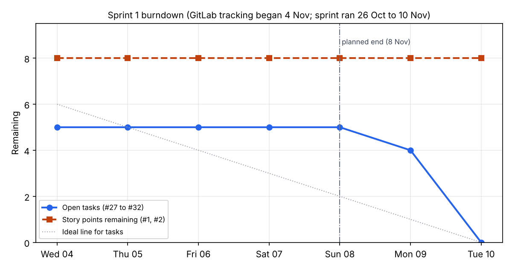

# Sprint 1: monorepo, API, data model, auth, CI

- Dates: 26 Oct to 10 Nov 2026 (extended from 8 Nov on 9 Nov to finish the remaining Sprint 1 tasks)
- Sprint goal: a deployed, tested API skeleton with sign-in and squads, and the project management backbone in place.
- Committed stories: #1 sign in (3), #2 create a squad and invite (5), plus estimated setup tasks.

## Planning

| Item | Points | Notes |
| --- | --- | --- |
| #1 Sign in | 3 | |
| #2 Create a squad and invite | 5 | |
| Setup: GitLab, CI, monorepo, staging | | estimate these too |

## Progress note (updated 4 Nov, for the review)

Facts from the repository and GitLab on 4 Nov. Review results and the retrospective are Peter's to write.

Merged to `main`:

- Monorepo skeleton (pnpm, Turborepo), `/health` endpoint, `packages/analytics` session load, shared Zod schemas.
- Data model v1 and the init migration (DL-002, Proposed), with the ERD in `docs/design/erd.md`.
- GitLab CI (lint, typecheck, tests with coverage and JUnit) on a self-hosted runner (DL-003).
- #2, partly: create a squad and join by invite code, global auth guard with a swappable token verifier (DL-004).
- #1 in the API: Firebase ID-token verifier with valid, invalid and expired token tests (DL-009), and the fix
  for concurrent first sign-in and email conflicts.
- Expo app started early (DL-010): Firebase sign-in in the app, three-tab layout and all Figma V1 screens,
  most as labelled previews.
- CI on `main` (pipeline for `05a1537`, 3 Nov): 76 tests passing, 0 failed.

Project management, set up 4 Nov:

- GitLab issues #1 to #26 for the backlog, labelled by MoSCoW, requirement and story points (also set as
  issue weight). Completed acceptance criteria are ticked on #1 and #2.
- Milestones for Sprints 1 to 8 with stories assigned. The issues were created on 4 Nov, so the Sprint 1
  burndown starts on 4 Nov, not 26 Oct.
- "Sprint board" with To do, In progress and In review columns, and the remaining Sprint 1 and Sprint 2
  non-story work as task issues #27 to #42 (labels `task`, `spike`, `bug`).

Not done:

- #1: explicit health-data consent at first-time setup (DL-008) and keeping the sign-in on the phone.
- #2: no squad member list yet.
- Azure staging: moved to Sprint 2.
- Ethics application: moved to the start of Sprint 2 (4 Nov).
- Real PostgreSQL integration tests: the API tests fake the database, so constraints,
  transactions and real queries are not yet tested.

Design work: athlete app screens V1 in Figma, light and dark (see `docs/design/README.md`). Not user tested.

Known issues (now tracked in `docs/issue-log.md`):

- `SessionType` is uppercase in Prisma (`TRAINING`) and lowercase in Zod (`training`). Fix
  decided: make `SessionTypeSchema` uppercase, matching Prisma and `StaffRoleSchema`, so no
  mapping or migration is needed. Do it at the start of #4; nothing uses the schema yet.

Fixed since the 3 Nov note: `AuthService.authenticate` returning a 500 on a concurrent first sign-in or
an email already linked to another Firebase ID (now returns the existing user or 409; regression tests added).

Planning change: the remaining MVP work is reordered athlete-first (DL-005; see
`requirements-changes.md`).

## Review (10 Nov)

Held on 10 Nov after the two-day extension (the planned review on Fri 6 Nov did not happen).
Drafted by Claude Code at Peter's request from GitLab, CI and the repository records.
Confirmed by Peter on 10 Nov.

### Delivered vs committed

| Item | Committed | Result |
| --- | --- | --- |
| #1 Sign in (3 pts) | Yes | **Not done.** 3 of 4 acceptance criteria met: Firebase sign-in in the API and the app, clear errors, no stored passwords. AC4 (health-data consent stored at setup, DL-008) remains. Moves to Sprint 2. |
| #2 Create a squad and invite (5 pts) | Yes | **Not done.** 2 of 3 met: create a squad, join by invite code. The member list remains, planned for Sprint 3 week 7 with the other staff features (DL-005). Moves to Sprint 3. |
| #27 Error format and validation | Task | Done 4 Nov (DL-012, merge request !6) |
| #28 NFR rewrite | Task | Done 9 Nov (`docs/non-functional-requirements.md`, new NFR 5) |
| #29 Navigation map | Task | Done 10 Nov (`docs/design/navigation-map.md`) |
| #30 Dissertation template and Zotero | Task | Done 10 Nov |
| #31 Planning notes: effort for setup tasks | Task | Won't do: setup tasks were never estimated, and estimating afterwards would not be meaningful |
| #32 This review and retrospective | Task | Done 10 Nov |

Also delivered, outside the GitLab tasks: monorepo, data model v1 and migration, self-hosted CI, global
auth guard, Expo app with all Figma V1 screens (most as labelled previews), GitLab backlog of 26 stories
with milestones and a board, decision log DL-001 to DL-012.

Moved out during the sprint, all recorded in `requirements-changes.md`: Azure staging and the API
container (to Sprint 2), the ethics application (to the start of Sprint 2), and the sprint end date
(8 to 10 Nov).

### Measured velocity

- **0 story points** of 8 committed. Partly finished stories do not count.
- Tasks: 4 of 6 done, 1 won't do, plus this review.
- Tests: 87 passing, 0 failing, on the last full CI run on `main` (`415f13f`, 10 Nov). Up from 39 on 3 Nov.

### Burndown

GitLab tracking began on 4 Nov, so the chart covers 4 to 10 Nov only. Story points stayed at 8 because
neither story closed. Only one task closed before the planned end date of 8 Nov; nothing closed between
5 and 8 Nov, and the rest closed during the extension.

## Retrospective

Drafted by Claude Code at Peter's request from the sprint's records and decisions.
Confirmed by Peter on 10 Nov.

### What went well

- **Engineering foundations are solid.** CI ran lint, typecheck and tests on every change, and tests grew
  from 39 to 87. Sign-in was written tests first, and the concurrent first sign-in bug was fixed with a
  regression test before it reached users.
- **Decisions were recorded as they were made** (DL-005 to DL-012), including the athlete-first reorder and
  the branching rule, so the reasons behind the plan are traceable.
- **Unknowns were tackled early.** Expo and Firebase sign-in were proven on 3 Nov, a week ahead of plan.
- **The project management backbone now exists:** backlog, milestones, board, issue log and measurable
  NFRs, so Sprint 2 starts with planned, traceable work.

### What didn't go well

- **No story was finished.** Both stories were larger than one sprint once the athlete-first reorder (DL-005)
  moved their remaining parts later. Velocity is 0, so Sprint 2 cannot be planned from velocity yet.
- **Setup tasks were never estimated** (#31), so the effort that went into Sprint 1 is not measurable.
- **GitLab tracking started late.** Issues and the board only existed from 4 Nov, the second week, so the
  first half of the sprint has no burndown.
- **Work bunched at the end.** Nothing closed from 5 to 8 Nov; the sprint needed a two-day extension and
  the planned 6 Nov review was missed.
- **The ethics application slipped twice** and is now the biggest risk to the November interviews (R10).
- **The self-hosted runner is unreliable.** Three pipelines on `main` failed for runner reasons: the Docker
  image pull failed (4 Nov), the runner timed out (9 Nov), and the npm registry could not be reached
  (10 Nov). The code passed each time it ran. This is a trade-off of DL-003.
- **Credentials were stored in plain text** in a synced project folder (the GitHub mirror note).

### One change for Sprint 2

**Estimate every task, not just stories, at sprint planning, and split any story that cannot be finished
inside one sprint**, so velocity measures real progress.

### Actions

- Submit the ethics application first thing in Sprint 2 (#33).
- Revoke and replace the tokens in the mirroring note; record the GitHub mirror as DL-013.
- Move #1 to Sprint 2 and #2 to Sprint 3, and close the Sprint 1 milestone.
- Watch runner failures in Sprint 2; if they continue, record the options in the decision log.
