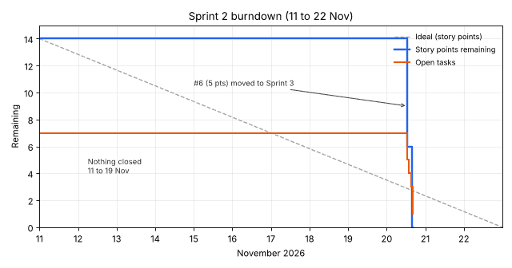

# Sprint 2: health-data consent, wellness, session logging, staging

- Dates: 11 to 22 Nov 2026 (shortened from 9 Nov on 9 Nov, after Sprint 1's extension)
- Sprint goal: an athlete can sign in, give health-data consent, record a daily wellness check and log a
  session through the real API, running on Azure staging.
- Committed stories: #1 sign in, carried from Sprint 1 (3), #4 log a session (3), #5 daily wellness
  check (3), #6 offline logging and sync (5). 14 points.

## Review (20 Nov)

Held on 20 Nov, two days before the planned end. Drafted by Claude Code at Peter's request from GitLab,
CI and the repository records. Peter to confirm.

### Delivered vs committed

| Item | Committed | Result |
| --- | --- | --- |
| #1 Sign in (3 pts) | Yes | **Done.** AC4, health-data consent at setup with its history and a 403 on health writes without it (DL-008), delivered in !8 (API) and !10 (app) |
| #4 Log a session (3 pts) | Yes | **Done, one criterion moved.** AC1 to AC3 in !12; AC4's Latest session card on Today in !14. "Including any still waiting to sync" moved to #6 AC4, because that state only exists once offline sync does |
| #5 Daily wellness check (3 pts) | Yes | **Done, one criterion moved.** AC2 and AC3 in !11. AC1 (under 60 s in user testing) moved to the Sprint 3 usability test #44; #5 is reopened if any participant takes 60 s or more |
| #6 Offline logging and sync (5 pts) | Yes | **Moved to Sprint 3** on 20 Nov, with its spike #35 and design notes #40: the spike needed #4 and #5 writing through the API first |
| #33 Ethics application | Task | Done. Submitted 10 Nov; approved in person by the supervisor (reported 20 Nov). Written confirmation still to be saved (I-8) |
| #34 Azure staging | Task | Done, one criterion split. API image, staging on Azure Container Apps (Norway East) with `/health` ok, DL-014 and DL-015. Automatic deploy from CI split into #43: the QUB tenant refused a service principal |
| #36 SessionType bug | Bug | Done 10 Nov (!7) |
| #37 Interview questions | Task | Done 10 Nov |
| #38 Competitor comparison | Task | Done 20 Nov (`docs/research/competitor-comparison.md`), drafted by Claude Code, approved by Peter |
| #39 Use cases | Task | Done 20 Nov (`docs/design/use-cases.md`), drafted by Claude Code, approved by Peter |
| #35, #40 | Task | Moved to Sprint 3 with #6 |
| #41 Book interviews | Task | Moved to Sprint 3 by Peter on 20 Nov; unblocked by ethics approval |
| #42 This review | Task | This document |

Merged in the sprint: !8 to !14 (consent API and app, wellness, sessions, API Dockerfile, CI image
publishing, real Latest session card). Staging runs `main` at `c6626142` (deployed 16:08, 20 Nov).

New in Sprint 3 because of this sprint: #43 automatic deploy from CI (blocked on a service principal),
#44 usability test for NFR 1. Every move is recorded in `requirements-changes.md`.

### Measured velocity

- **9 story points** of 14 committed (#1, #4, #5). #6 (5) was moved, not finished. Two of the
  finished stories closed with one criterion moved to another issue, so the honest reading is 9 points
  of built and merged work, with the user-test and sync-display checks still to come.
- Tasks: 7 done (#33, #34, #36, #37, #38, #39, and this review), 4 moved to Sprint 3.
- Tests: **176 passing, 0 failing** on `main` (pipeline for `c6626142`): API 107, mobile 60,
  analytics 9. Up from 87 at the end of Sprint 1.
- First sprint with "deployed to staging" in the Definition of Done met.

### Burndown

Story points stayed at 14 from 11 to 19 Nov and dropped to 0 on 20 Nov: #6 was moved out (12:44),
then #1, #5 and #4 closed between 12:59 and 15:59. The repository shows one commit from 11 to 19 Nov
(the move to the Software Engineering GitLab on 14 Nov, DL-013) and 35 on 20 Nov.

## Retrospective

Drafted by Claude Code at Peter's request from the sprint's records. Peter to confirm, and to add his
own reflections where marked.

### What went well

- **All three remaining athlete stories were built, reviewed and merged**, with CI green on every merge
  request and tests up from 87 to 176. Consent, wellness and session logging now write through the real
  API with validation, a consent guard and one-entry-per-day protection.
- **Staging exists for the first time.** The API runs on Azure from the same image CI builds, the
  database is free for 12 months, and the app scales to zero, meeting NFR 5.3.
- **Blockers were handled in the open.** The region policy, the express environment, the refused service
  principal and the moved criteria are all recorded (DL-014, DL-015, I-9, I-10,
  `requirements-changes.md`) instead of being worked around quietly.
- **Ethics was approved**, unblocking interviews and usability testing.

### What didn't go well

- **Nothing was closed for nine days, then everything on one day.** From 11 to 19 Nov there was one
  commit; on 20 Nov there were 35, using several Claude Code workers in parallel. The burndown is a cliff,
  not a slope, and Sprint 1 had the same pattern. TODO: Peter: why 11 to 19 Nov went (coursework, work,
  the GitLab move?).
- **Most of the code was written by AI in one session.** It is reviewed and tested, but Peter has to be
  able to explain every merged change in the demo and viva. Reading through !8 to !14 is part of the
  Sprint 3 plan.
- **Staging took about 75 minutes longer than planned** (I-9): UK South was blocked, the CLI created an
  express environment by default, and a bad Docker Hub token was stored and reused.
- **Secrets were pasted into the chat** (a runner token, a database password in command output, two
  Docker Hub tokens) and had to be rotated. The same mistake as Sprint 1's plain-text credentials.
- **Parallel branches conflicted on the AI usage log**, twice, because each branch appended a row to the
  same file.
- **Two stories closed by moving a criterion.** Both moves are justified and recorded, but two in one
  sprint is a pattern to watch: acceptance criteria that depend on other stories or on user testing
  should be written into those issues at planning, not moved at the end.
- **#6 was committed but never started.** Its spike depended on #4 and #5, which were not done until the
  last day.

### One change for Sprint 3

**Close something every few days.** Plan Sprint 3 so a story or task can close by the end of each
week, and check the burndown at the midpoint, so slippage shows while there is time to act.

### Actions

- Save the written ethics confirmation in the `Ethics` folder (I-8) before any interview or usability
  session.
- Ask the supervisor whether QUB IT can create a service principal for `loadwise-staging` (#43).
- Never paste a token, password or command output containing one into a chat; load secrets with
  `read -rs` and test tokens with `curl` before using them.
- When working in parallel, add the AI usage log rows on `main` after the merges, not in each branch.
- Add a `changes:` rule so the `api-image` job skips documentation-only pushes (saves about 4 minutes of
  runner time per push, NFR 5).
- Read through !8 to !14 before the Sprint 3 midpoint, so every merged change can be explained.
- Sprint 3 overlaps the CSC3067 and CSC3045 deadlines (7 and 8 Dec) and now also holds #6, #35, #40,
  #41, #43 and #44: re-plan it at Sprint 3 planning with the R11 fallbacks in mind.
